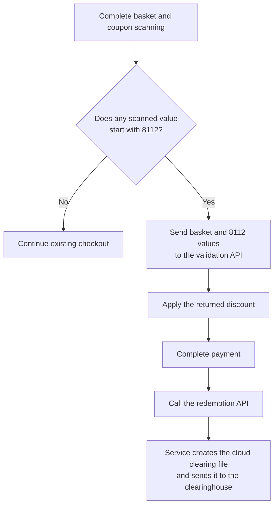

# 8112 Universal Coupon Redemption — High-Level Guide

## 1. How to identify an 8112 Universal Coupon

The POS only needs one detection rule:

```text
Anything scanned that starts with 8112 is an 8112 Universal Coupon.
```

Preserve the complete scanned value exactly as received. Do not truncate,
reformat, split, or parse it in the POS.

If no scanned value starts with `8112`, continue the existing checkout flow
without calling the 8112 service.

## 2. Coupon code types

### Standard coupon code

A standard 8112 coupon code represents one serialized coupon.

Example:

```text
8112209988459000329165266614604064
```

The POS sends the complete value to the 8112 service without interpreting its
length or internal structure.

### Fetch code

A fetch code is a shorter 8112 value that may represent one or more coupons.

Example:

```text
8112209988459000
```

The POS sends the fetch code exactly as scanned. The 8112 service calls TCB and
resolves it into the applicable serialized coupons. The POS does not need to
resolve the fetch code itself.

## 3. Checkout process



The retailer may configure Universal 8112 coupons to run before or after the
loyalty promotion engine. Products discounted by the first promotion engine
must not be reused by the second promotion engine.

## 4. Validate the basket

After scanning is complete, send the basket and all scanned values beginning
with `8112` to:

```http
POST /coupons_valid_for_basket
Content-Type: application/json
x-api-key: RETAILER_WEBHOOK_API_KEY
```

Example request:

```json
{
  "basket": [
    {
      "product_code": "037000930396",
      "price": 1.29,
      "quantity": 2,
      "unit": "item"
    },
    {
      "product_code": "037000934677",
      "price": 1.34,
      "quantity": 2,
      "unit": "item"
    }
  ],
  "coupons": [
    "8112209988459000329165266614604064",
    "8112209988459000"
  ]
}
```

Example response:

```json
{
  "basket_validation_output": {
    "discount_in_cents": 100,
    "applied_coupons": [
      {
        "coupon_code": "8112209988459000329165266614604064",
        "face_value_in_cents": 100,
        "product_codes": {
          "gtins": ["037000930396"]
        }
      }
    ]
  }
}
```

Apply `discount_in_cents` and retain the returned `coupon_code` values for
final redemption. The service handles coupon resolution and validation.

## 5. Redeem after payment

After payment succeeds, send only the applied coupon codes to:

```http
POST /redeem_coupons
Content-Type: application/json
x-api-key: RETAILER_WEBHOOK_API_KEY
```

Example request:

```json
{
  "coupons": [
    "8112209988459000329165266614604064"
  ]
}
```

The redemption API takes care of final TCB redemption. The POS does not need to
parse the coupon, construct a TCB request, or manage TCB credentials.

The service records confirmed redemptions, creates the clearing file in the
cloud, and sends it to the clearinghouse.

## 6. Roll back a voided transaction

If a completed transaction is voided after redemption, call:

```http
POST /rollback_coupons
Content-Type: application/json
x-api-key: RETAILER_WEBHOOK_API_KEY
```

```json
{
  "coupons": [
    "8112209988459000329165266614604064"
  ]
}
```

The service handles the rollback and excludes successfully rolled-back coupons
from clearing.

## 7. POS implementation summary

1. Detect scanned values that start with `8112`.
2. Preserve each complete value exactly as scanned.
3. Send the completed basket and 8112 values to the validation API.
4. Apply only the returned discount.
5. Complete payment.
6. Call the redemption API with the applied coupon codes.
7. Call rollback only if the redeemed transaction is later voided.

The POS is not responsible for parsing coupon data, resolving fetch codes, or
performing TCB redemption logic.
