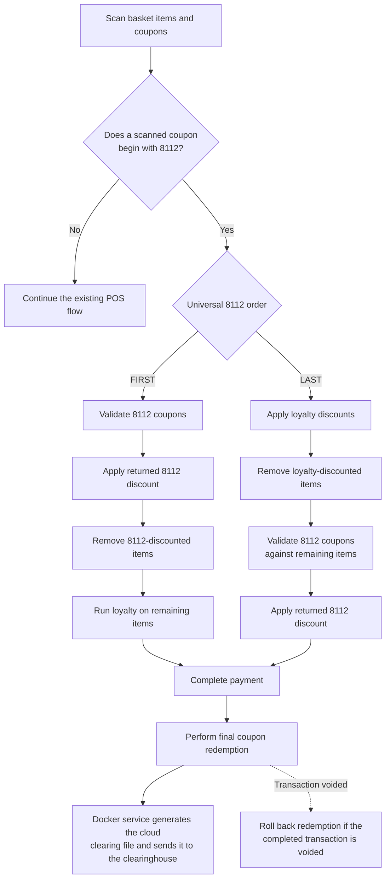

# 8112 Universal Coupon Redemption — High-Level Guide

## 1. Purpose

This document explains how a POS implementer identifies and processes an 8112
Universal Coupon from scan through final redemption.

For this integration, a scanned numeric value beginning with `8112` is routed
to the 8112 coupon workflow. The POS should preserve the complete scanned value
as a string and must not truncate, reformat, or attempt to interpret it as a
UPC.

The 8112 value may represent:

- one serialized coupon;
- multiple concatenated serialized coupons;
- a 16-digit fetch code that resolves to one or more serialized coupons; or
- a non-serialized coupon identifier that TCB resolves into a serialized
  coupon.

The SDK or hosted webhook handles the detailed parsing and resolution. The POS
only needs to detect the `8112` prefix and submit the complete scanned value.

## 2. High-level process



The retailer controls whether the Universal 8112 coupon is processed `FIRST`
or `LAST` relative to loyalty. Items discounted by the first promotion engine
must be removed from eligibility before the second promotion engine runs.

## 3. 8112 data-string types

### 3.1 Standard serialized coupon

A standard serialized consumer coupon:

- begins with `8112`;
- contains digits only;
- contains the base GS1 plus a 16-digit serial component; and
- has a variable total length determined by data encoded in the coupon.

Example:

```text
8112209988459000329165266614604064
```

Resolved representation:

```json
{
  "gs1": "8112209988459000329165266614604064",
  "base_gs1": "811220998845900032",
  "validated": false
}
```

The SDK parses this format locally. `validated: false` means it was parsed
successfully but has not yet been validated against TCB for coupon status.

The POS must not assume a fixed serialized-coupon length. For example, the SDK
also supports this longer valid serialized value:

```text
8112069988556677440000019133301677522707
```

### 3.2 Concatenated serialized coupons

One scan may contain multiple complete serialized coupons concatenated into a
single numeric string. The SDK determines each coupon's length dynamically and
returns every serialized coupon in the original order.

Example containing two coupons:

```text
81122099884590003291652666146040648112209988459000349165768322093822
```

Result:

```json
[
  {
    "gs1": "8112209988459000329165266614604064",
    "base_gs1": "811220998845900032",
    "validated": false
  },
  {
    "gs1": "8112209988459000349165768322093822",
    "base_gs1": "811220998845900034",
    "validated": false
  }
]
```

### 3.3 16-digit fetch code

A 16-digit fetch code begins with `8112` but is not itself a serialized coupon.
It is a reference that TCB expands into one or more serialized coupons.

Example:

```text
8112209988459000
```

Each 16-digit fetch code is sent to TCB in its own request. Multiple fetch-code
requests may run in parallel. The SDK returns only coupons included in TCB's
`newly_redeemed` response.

One fetch code may resolve to multiple coupons:

```json
[
  {
    "gs1": "8112209988459000329165266614604064",
    "base_gs1": "811220998845900032",
    "validated": true
  },
  {
    "gs1": "8112209988459000349165768322093822",
    "base_gs1": "811220998845900034",
    "validated": true
  }
]
```

`validated: true` indicates that TCB returned the coupon in
`newly_redeemed` during fetch-code resolution.

### 3.4 Non-serialized coupon identifier

Some scanned 8112 values are neither a locally parseable serialized coupon nor
a 16-digit fetch code.

Example:

```text
8112209988459000320001
```

The SDK sends these values to TCB for resolution. They are grouped into batches
of up to 15 values, and independent batches run in parallel. A returned coupon
is matched using the TCB `master_offer_file` and returned as its complete
serialized GS1 plus `base_gs1`.

## 4. How the POS recognizes an 8112 Universal Coupon

The POS integration rule is intentionally simple:

```text
If the scanned coupon value starts with 8112, route it to the 8112 workflow.
```

The POS should not:

- require a fixed length after detecting `8112`;
- reject a 16-digit value because it is shorter than a serialized coupon;
- split a long value into fixed-size segments;
- calculate `base_gs1` itself; or
- send customer PII with the basket.

The SDK or webhook determines the exact data-string type and returns the
resolved coupon information.

## 5. Basket validation

After scanning is complete, send the basket and all scanned 8112 values to:

```http
POST /coupons_valid_for_basket
Content-Type: application/json
x-api-key: RETAILER_WEBHOOK_API_KEY
```

Example request:

```json
{
  "basket": [
    {
      "product_code": "037000930396",
      "price": 1.29,
      "quantity": 2,
      "unit": "item"
    },
    {
      "product_code": "037000934677",
      "price": 1.34,
      "quantity": 2,
      "unit": "item"
    }
  ],
  "coupons": [
    "8112209988459000329165266614604064",
    "8112209988459000"
  ]
}
```

Example response:

```json
{
  "basket_validation_output": {
    "discount_in_cents": 100,
    "applied_coupons": [
      {
        "coupon_code": "8112209988459000329165266614604064",
        "face_value_in_cents": 100,
        "product_codes": {
          "gtins": ["037000930396"]
        }
      }
    ]
  }
}
```

The POS applies `discount_in_cents` and retains the returned `coupon_code`
values for final redemption. When 8112 runs first, remove the returned GTINs
from loyalty eligibility before running loyalty.

## 6. Final redemption

Call final redemption only after payment succeeds, using only the coupon codes
returned as applied during basket validation:

```http
POST /redeem_coupons
Content-Type: application/json
x-api-key: RETAILER_WEBHOOK_API_KEY
```

```json
{
  "coupons": [
    "8112209988459000329165266614604064"
  ]
}
```

Only coupons returned by TCB in `newly_redeemed` are treated as successfully
redeemed. The Docker service records confirmed redemptions, generates the
clearing file in the cloud, and sends it to the clearinghouse.

## 7. Rollback

If a successfully redeemed retail transaction is later voided within the
allowed rollback window, call:

```http
POST /rollback_coupons
Content-Type: application/json
x-api-key: RETAILER_WEBHOOK_API_KEY
```

```json
{
  "coupons": [
    "8112209988459000329165266614604064"
  ]
}
```

Successfully rolled-back coupons are excluded from clearing.

## 8. Implementation checklist

1. Add retailer settings to enable 8112, configure the webhook base URL and API
   key, and select whether Universal 8112 runs `FIRST` or `LAST`.
2. Preserve every scanned value beginning with `8112` exactly as scanned.
3. Complete the basket before requesting coupon validation.
4. Send only basket data and 8112 coupon values; do not send customer PII.
5. Apply only the discount and coupons returned by validation.
6. Prevent the second promotion engine from reusing items discounted by the
   first promotion engine.
7. Perform final redemption only after successful payment.
8. Roll back redeemed coupons when the completed transaction is voided.
