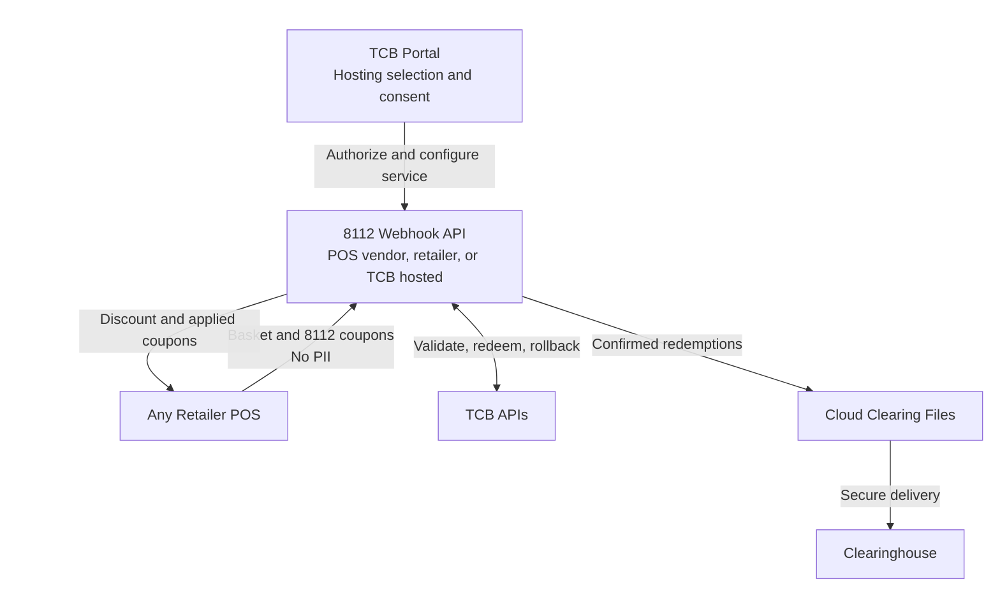
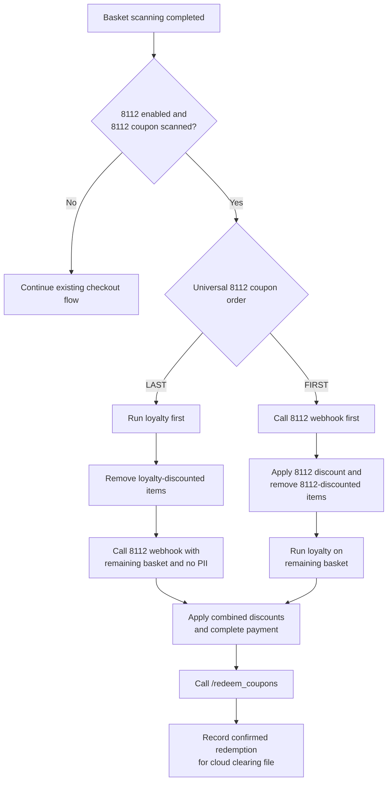

# 8112 POS Webhook Integration Guide

## 1. Proposed architecture

TCB provides the 8112 webhook as Dockerized code. Every POS vendor integrates
with the same API contract; only the configured service base URL and
retailer-created API key change.

The retailer chooses one of three hosting models:

1. the POS vendor hosts the Dockerized webhook in the POS vendor cloud;
2. the retailer hosts the Dockerized webhook in the retailer cloud; or
3. the retailer uses a TCB-hosted version after the retailer grants consent in
   the TCB Portal.

The TCB Portal records the retailer's hosting selection, consent, and service
configuration. TCB connectivity is configured inside the deployed service and
is not exposed as part of the POS API.

The POS detects scanned values beginning with `8112`, sends only the basket and
8112 coupon values to the retailer webhook, receives the applicable discount,
and applies that discount at checkout. No customer PII is required.



### Responsibility model

| Participant | Responsibility |
| --- | --- |
| TCB | Provides the Dockerized webhook code and can provide the hosted service when authorized by the retailer. |
| TCB Portal | Records retailer consent, hosting selection, service configuration, and retailer-created API key settings. |
| Retailer | Selects the hosting model, creates the webhook API key, authorizes a TCB-hosted service when selected, and controls clearinghouse delivery. |
| POS vendor | Implements the common API contract once for every POS and may host the Dockerized webhook when selected by the retailer. |
| 8112 webhook | Calls the SDK and TCB APIs, returns discounts, redeems or rolls back coupons, and writes confirmed redemptions for clearing. |
| Clearing process | Generates and securely delivers clearing files from confirmed redemption records. |

## 2. POS configuration

The POS vendor implements one common API contract for every POS and configures
the base URL selected by the retailer:

```text
https://coupon-api.retailer.example
```

The POS provides a retailer configuration placeholder with these settings:

| Setting | Description |
| --- | --- |
| `enable_8112` | Enables or disables universal 8112 coupon processing. |
| `8112_base_url` | Base URL of the POS-vendor-hosted, retailer-hosted, or TCB-hosted webhook. |
| `8112_api_key` | Webhook API key created and controlled by the retailer. |
| `universal_8112_coupon_order` | `FIRST` runs universal 8112 coupons before loyalty. `LAST` runs them after loyalty. |

If `enable_8112` is false, or the completed scan contains no `8112` coupon,
the POS does not call the webhook and continues its existing checkout flow.

The webhook exposes the same endpoint paths as the reference POS API:

| Method | Path | Purpose |
| --- | --- | --- |
| `POST` | `/coupons_valid_for_basket` | Validates the scanned coupons and returns the applicable discount. Does not perform final redemption. |
| `POST` | `/redeem_coupons` | Performs final redemption after the retail transaction succeeds. |
| `POST` | `/rollback_coupons` | Rolls back redeemed coupons when a completed transaction is voided within the allowed rollback window. |

All requests use `Content-Type: application/json`. The hosted service exposes
only these business endpoints to the POS. The POS sends the API key created by
the retailer in:

```text
x-api-key: RETAILER_WEBHOOK_API_KEY
```

TCB connectivity and authentication remain internal to the Dockerized or
TCB-hosted service and are never sent to the POS.

## 3. Configurable checkout flow



### Promotion order and anti-stacking

The retailer controls promotion order through
`universal_8112_coupon_order`:

- `LAST`: run loyalty first, apply its discounts, remove the products
  discounted by loyalty, and send only the remaining basket plus scanned 8112
  coupons to `/coupons_valid_for_basket`.
- `FIRST`: call `/coupons_valid_for_basket` first, apply the returned 8112
  discount, remove the products identified in
  `applied_coupons[].product_codes.gtins`, and run loyalty against the remaining
  basket.

Items discounted by the first promotion engine must not be eligible for the
second engine. This provides cross-engine anti-stacking while the 8112 SDK
continues to handle anti-stacking between multiple 8112 coupons.

If a redeemed transaction is voided, the POS calls `/rollback_coupons`. A
validation request that is never followed by successful payment must not be
included in a clearing file.

## 4. Validate basket and coupons

The POS calls this endpoint after basket scanning is complete, 8112 processing
is enabled, and one or more `8112` coupon values were scanned. The basket sent
to this endpoint depends on `universal_8112_coupon_order`:

- `FIRST`: send the completed basket before loyalty discounts are applied.
- `LAST`: run loyalty first, remove loyalty-discounted items, and send the
  remaining basket.

```http
POST /coupons_valid_for_basket
Content-Type: application/json
x-api-key: RETAILER_WEBHOOK_API_KEY
```

Request:

```json
{
  "basket": [
    {
      "product_code": "037000930396",
      "price": 1.29,
      "quantity": 2,
      "unit": "item"
    },
    {
      "product_code": "037000934677",
      "price": 1.34,
      "quantity": 2,
      "unit": "item"
    }
  ],
  "coupons": [
    "8112009988459000019133924009755364",
    "8112209988459000350001"
  ]
}
```

Only these data categories are needed:

- basket product code, unit price, quantity, and unit
- scanned `8112` coupon values

Do not send customer name, email, phone number, loyalty profile, payment-card
data, receipt image, or other consumer PII.

Response:

```json
{
  "basket_validation_output": {
    "discount_in_cents": 100,
    "applied_coupons": [
      {
        "coupon_code": "8112009988459000019133924009755364",
        "face_value_in_cents": 100,
        "product_codes": {
          "gtins": ["037000930396"]
        }
      }
    ]
  },
  "execution_time_in_ms": 42
}
```

The POS applies `basket_validation_output.discount_in_cents`. It saves the
`coupon_code` values returned in `applied_coupons` for final redemption. When
8112 runs first, the POS also removes the returned
`applied_coupons[].product_codes.gtins` from loyalty eligibility. An empty
`applied_coupons` array means no 8112 discount should be applied.

This endpoint validates only. It must not create a clearing record or perform
final coupon redemption.

## 5. Redeem coupons after payment

After payment succeeds, redeem only the coupon codes returned by validation:

```http
POST /redeem_coupons
Content-Type: application/json
x-api-key: RETAILER_WEBHOOK_API_KEY
```

Request:

```json
{
  "coupons": [
    "8112009988459000019133924009755364"
  ]
}
```

Response:

```json
{
  "redeemed_coupons": {
    "status": "success",
    "status_code": "FULL_REDEMPTION",
    "newly_redeemed": [
      {
        "gs1": "8112009988459000019133924009755364",
        "master_offer_file": "811200998845900001"
      }
    ],
    "total_gs1s_processed": 1,
    "message": "Redeemed 1 gs1(s)"
  },
  "execution_time_in_ms": 68
}
```

The retailer webhook must:

1. rely on the SDK-generated `client_txn_id` for idempotent network retries;
2. store only coupons returned in `newly_redeemed` as successfully redeemed;
3. return partial redemption details rather than assuming every submitted
   coupon succeeded; and
4. write confirmed redemption records to the cloud clearing ledger.

## 6. Roll back a voided transaction

When a redeemed transaction is voided within the TCB rollback window:

```http
POST /rollback_coupons
Content-Type: application/json
x-api-key: RETAILER_WEBHOOK_API_KEY
```

Request:

```json
{
  "coupons": [
    "8112009988459000019133924009755364"
  ]
}
```

Response:

```json
{
  "rolled_back_coupons": {
    "8112009988459000019133924009755364": "{\"status\":\"success\",\"message\":\"Coupon rollback successful\"}"
  },
  "execution_time_in_ms": 51
}
```

Successfully rolled-back coupons must be excluded from future clearing files.

The Docker container generates the clearing file in the cloud and sends it to
the clearinghouse. This process is handled automatically by the container.
