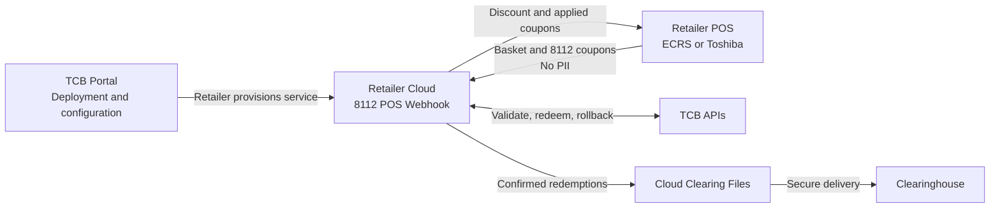
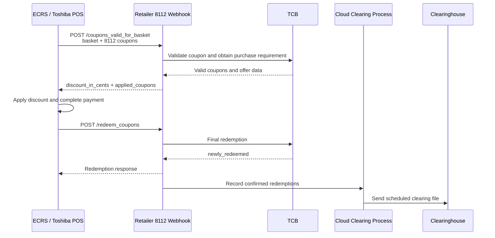

# Retailer-Hosted 8112 POS Webhook Integration Guide

## 1. Proposed architecture

The retailer hosts a lightweight 8112 webhook service in the retailer cloud.
The TCB Portal makes the deployment package and required configuration
available to the retailer. POS vendors such as ECRS and Toshiba configure one
retailer-owned base URL and use the standard paths documented below. Every POS
integrator calls the same API contract; only the retailer base URL and
retailer-issued webhook credential change.

The POS detects scanned values beginning with `8112`, sends only the basket and
8112 coupon values to the retailer webhook, receives the applicable discount,
and applies that discount at checkout. No customer PII is required.

The webhook uses TCB APIs directly. It does not require Redis, a locally
synchronized Master Offer File store, or another local offer database.



### Responsibility model

| Participant | Responsibility |
| --- | --- |
| TCB Portal | Provides the webhook deployment package, TCB environment configuration, and retailer onboarding instructions. |
| Retailer | Hosts, secures, scales, and monitors the webhook. Stores TCB and clearinghouse credentials in its cloud secret manager. |
| POS integrator, including ECRS / Toshiba | Implements the common API contract once, detects `8112`, sends the basket and coupon values, applies the returned discount, and calls redemption after payment succeeds. |
| Retailer webhook | Calls the SDK and TCB APIs, returns discounts, redeems or rolls back coupons, and writes confirmed redemptions for clearing. |
| Clearing process | Generates and securely delivers clearing files from confirmed redemption records. |

## 2. POS configuration

The POS integrator implements one common API contract and configures one
retailer-owned base URL for each retailer:

```text
https://coupon-api.retailer.example
```

The webhook exposes the same endpoint paths as the reference POS API:

| Method | Path | Purpose |
| --- | --- | --- |
| `POST` | `/get_access_token` | Returns the webhook's current TCB access token. This should normally be restricted to retailer operations and diagnostics. |
| `POST` | `/coupons_valid_for_basket` | Validates the scanned coupons and returns the applicable discount. Does not perform final redemption. |
| `POST` | `/redeem_coupons` | Performs final redemption after the retail transaction succeeds. |
| `POST` | `/rollback_coupons` | Rolls back redeemed coupons when a completed transaction is voided within the allowed rollback window. |

All business requests use `Content-Type: application/json`. When the retailer
configures webhook authentication, the POS sends the retailer-issued key in:

```text
x-api-key: RETAILER_WEBHOOK_API_KEY
```

TCB access keys, secret keys, and access tokens remain inside the retailer
cloud and are never sent to the POS or POS vendor.

## 3. Simple checkout flow



If a redeemed transaction is voided, the POS calls `/rollback_coupons`. A
validation request that is never followed by successful payment must not be
included in a clearing file.

## 4. Validate basket and coupons

The POS calls this endpoint after detecting one or more `8112` coupon values:

```http
POST /coupons_valid_for_basket
Content-Type: application/json
x-api-key: RETAILER_WEBHOOK_API_KEY
```

Request:

```json
{
  "basket": [
    {
      "product_code": "037000930396",
      "price": 1.29,
      "quantity": 2,
      "unit": "item"
    },
    {
      "product_code": "037000934677",
      "price": 1.34,
      "quantity": 2,
      "unit": "item"
    }
  ],
  "coupons": [
    "8112009988459000019133924009755364",
    "8112209988459000350001"
  ]
}
```

Only these data categories are needed:

- basket product code, unit price, quantity, and unit
- scanned `8112` coupon values

Do not send customer name, email, phone number, loyalty profile, payment-card
data, receipt image, or other consumer PII.

Response:

```json
{
  "basket_validation_output": {
    "discount_in_cents": 100,
    "applied_coupons": [
      {
        "coupon_code": "8112009988459000019133924009755364",
        "face_value_in_cents": 100,
        "product_codes": {
          "gtins": ["037000930396"]
        }
      }
    ]
  },
  "execution_time_in_ms": 42
}
```

The POS applies `basket_validation_output.discount_in_cents`. It saves the
`coupon_code` values returned in `applied_coupons` for final redemption. An
empty `applied_coupons` array means no 8112 discount should be applied.

This endpoint validates only. It must not create a clearing record or perform
final coupon redemption.

## 5. Redeem coupons after payment

After payment succeeds, redeem only the coupon codes returned by validation:

```http
POST /redeem_coupons
Content-Type: application/json
x-api-key: RETAILER_WEBHOOK_API_KEY
```

Request:

```json
{
  "coupons": [
    "8112009988459000019133924009755364"
  ]
}
```

Response:

```json
{
  "redeemed_coupons": {
    "status": "success",
    "status_code": "FULL_REDEMPTION",
    "newly_redeemed": [
      {
        "gs1": "8112009988459000019133924009755364",
        "master_offer_file": "811200998845900001"
      }
    ],
    "total_gs1s_processed": 1,
    "message": "Redeemed 1 gs1(s)"
  },
  "execution_time_in_ms": 68
}
```

The retailer webhook must:

1. rely on the SDK-generated `client_txn_id` for idempotent network retries;
2. store only coupons returned in `newly_redeemed` as successfully redeemed;
3. return partial redemption details rather than assuming every submitted
   coupon succeeded; and
4. write confirmed redemption records to the cloud clearing ledger.

## 6. Roll back a voided transaction

When a redeemed transaction is voided within the TCB rollback window:

```http
POST /rollback_coupons
Content-Type: application/json
x-api-key: RETAILER_WEBHOOK_API_KEY
```

Request:

```json
{
  "coupons": [
    "8112009988459000019133924009755364"
  ]
}
```

Response:

```json
{
  "rolled_back_coupons": {
    "8112009988459000019133924009755364": "{\"status\":\"success\",\"message\":\"Coupon rollback successful\"}"
  },
  "execution_time_in_ms": 51
}
```

Successfully rolled-back coupons must be excluded from future clearing files.

## 7. Access-token endpoint

The webhook obtains and refreshes TCB tokens using credentials stored in the
retailer cloud. POS validation, redemption, and rollback callers do not need
the TCB token.

The existing operational endpoint is:

```http
POST /get_access_token
x-api-key: RETAILER_WEBHOOK_API_KEY
```

Response:

```json
{
  "token": "YOUR_ACCESS_TOKEN"
}
```

Restrict this endpoint to retailer operations where possible. Do not log or
return the token in general POS transaction logs.

## 8. Retailer and accelerator modes

Retailer mode is the default. For accelerator processing, include these fields
in validation and redemption requests:

```json
{
  "mode": "accelerator",
  "retailer_email_domain": "retailer.example"
}
```

If `retailer_email_domain` is supplied and `mode` is omitted, the reference
webhook selects accelerator mode. Rollback accepts `mode` but does not require
`retailer_email_domain`.

## 9. Cloud clearing-file process

The webhook does not need a local offer database. It does require durable cloud
storage for confirmed redemption and settlement records.

The clearing process is:

1. Record only coupons confirmed in TCB `newly_redeemed`.
2. Store the coupon GS1, discount, redemption time, TCB execution ID, and
   clearing status in the retailer cloud clearing ledger.
3. Exclude failed, uncommitted, voided, or successfully rolled-back coupons.
4. Generate the clearinghouse file on the retailer's required schedule.
5. Encrypt and store the generated file in versioned cloud object storage.
6. Deliver the file through the clearinghouse-approved secure channel.
7. Record the clearinghouse acknowledgement or rejection for reconciliation.

Clearing-file generation and delivery are part of the proposed hosted webhook
service. They are not currently performed by the basket-validation SDK library
alone.

## 10. Security and availability

- Use TLS for all POS-to-webhook and webhook-to-TCB communication.
- Protect business routes with a retailer-controlled API key, signed token, or
  mTLS identity.
- Keep all TCB and clearinghouse credentials in the retailer secret manager.
- Never send TCB credentials to the POS vendor or lane.
- Preserve the SDK-generated redemption `client_txn_id` across network retries.
- Preserve the coupon order supplied by the POS.
- Use bounded timeouts, retries, health checks, and multiple service instances.
- Redact credentials and coupon payloads from general logs.
- If validation fails or times out, return an explicit failure and do not apply
  an unconfirmed manufacturer coupon discount.

## 11. Recommended POS behavior

1. Detect one or more scanned values beginning with `8112`.
2. Build the basket and coupon request without consumer PII.
3. Call `/coupons_valid_for_basket`.
4. Apply the returned `discount_in_cents` and associate each applied coupon
   with its returned GTINs.
5. Complete payment.
6. Call `/redeem_coupons` using only the applied coupon codes.
7. Save the redemption response with the retailer transaction.
8. Call `/rollback_coupons` only if the redeemed transaction is later voided.
