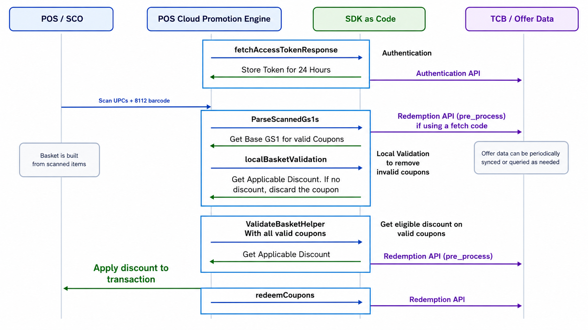
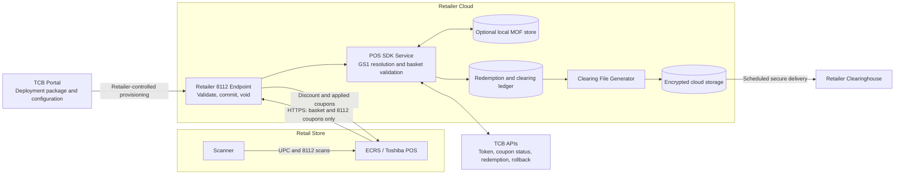

# POS Webhook and SDK Integration Guide



This guide is based on `Sdk as Code Integration Guide.odt` and aligned with the current Java SDK behavior in this repository.

## Proposed Retailer-Hosted 8112 Architecture

The recommended enterprise model is for each retailer to host the 8112 POS SDK
as a service inside the retailer's cloud environment. The TCB Portal can make
the signed deployment package and configuration available to the retailer.
POS vendors such as ECRS or Toshiba then support one retailer-configurable 8112
endpoint instead of embedding retailer-specific TCB credentials or offer data
inside every POS lane.

### High-level architecture



### Responsibility model

| Component | Responsibility |
| --- | --- |
| TCB Portal | Makes the SDK deployment package, environment configuration, and onboarding instructions available to the retailer. |
| Retailer | Hosts, secures, monitors, and scales the 8112 endpoint in the retailer cloud. Owns TCB and clearinghouse credentials. |
| ECRS / Toshiba POS | Detects an `8112` coupon, sends the basket and scanned 8112 values to the configured retailer endpoint, applies the returned discount, and confirms or voids the transaction. |
| Retailer-hosted SDK service | Resolves coupons, validates coupon status, calculates discounts, performs final redemption or rollback, and records successful redemption events. |
| Clearing file service | Builds clearing files only from successfully redeemed transactions, stores them durably, delivers them to the clearinghouse, and records acknowledgements or failures. |

### One configurable retailer endpoint

The POS should require only one configured URL, for example:

```text
https://coupon-api.retailer.example/8112
```

The same endpoint can accept an `operation` value so the POS integration remains
simple while preserving the required transaction lifecycle:

| Operation | When called | Result |
| --- | --- | --- |
| `validate` | After scanning the basket and 8112 coupons | Returns the discount, applied coupon list, and a retailer-generated `validation_id`. It does not finalize redemption. |
| `commit` | After payment succeeds | Redeems the applied coupons with TCB and writes the confirmed redemption to the clearing ledger. |
| `void` | When a committed transaction is cancelled within the allowed rollback window | Rolls back eligible redeemed coupons and updates the ledger. |

This two-phase `validate` then `commit` flow is required. Generating a clearing
record from the initial validation request could incorrectly clear coupons from
an abandoned or failed transaction.

### PII-free validation request

The POS sends only transaction identifiers, basket data, and 8112 coupon data.
Do not send customer name, email, phone number, loyalty profile, payment-card
data, or other consumer PII.

```json
{
  "operation": "validate",
  "transaction_id": "STORE101-LANE04-20261123-000184",
  "store_id": "STORE101",
  "lane_id": "LANE04",
  "basket": [
    {
      "product_code": "037000930396",
      "price": 1.29,
      "quantity": 2,
      "unit": "item"
    }
  ],
  "coupons": [
    "8112009988459000019133924009755364"
  ]
}
```

Example response:

```json
{
  "validation_id": "val_01JDB6N7Z8E2B5P3F4M6Q9R1ST",
  "transaction_id": "STORE101-LANE04-20261123-000184",
  "discount_in_cents": 100,
  "applied_coupons": [
    {
      "coupon_code": "8112009988459000019133924009755364",
      "face_value_in_cents": 100,
      "product_codes": {
        "gtins": ["037000930396"]
      }
    }
  ]
}
```

After payment succeeds, the POS confirms the transaction:

```json
{
  "operation": "commit",
  "validation_id": "val_01JDB6N7Z8E2B5P3F4M6Q9R1ST",
  "transaction_id": "STORE101-LANE04-20261123-000184"
}
```

The service must make `validate`, `commit`, and `void` idempotent by retailer,
store, and transaction ID. A repeated request must return the existing result
instead of applying, redeeming, or reversing the coupon twice.

### Clearing-file flow

1. A successful `commit` calls TCB final redemption.
2. The service stores only coupons confirmed in TCB `newly_redeemed` as redeemed.
3. The ledger records the retailer, store, transaction, coupon, discount,
   redemption timestamp, TCB execution ID, and reconciliation status.
4. A scheduled cloud job groups eligible ledger records into the clearinghouse
   file format.
5. The generated file is encrypted and written to versioned cloud storage.
6. The file is delivered through the clearinghouse-approved secure channel.
7. Clearinghouse acknowledgement or rejection is written back to the ledger;
   rejected records remain available for controlled retry and reconciliation.

### Security and operational requirements

- Use TLS for every POS-to-retailer and retailer-to-TCB connection.
- Authenticate the POS using retailer-controlled mTLS, signed tokens, or API
  credentials; do not expose TCB credentials to POS lanes or POS vendors.
- Keep access keys, secret keys, access tokens, and clearinghouse credentials in
  the retailer's managed secret store.
- Encrypt the redemption ledger and clearing files at rest.
- Redact credentials and coupon payloads from general application logs; retain
  transaction-safe audit identifiers for support and reconciliation.
- Deploy the endpoint across multiple instances or availability zones and use
  health checks, bounded timeouts, retries, and circuit breaking.
- If validation cannot be completed, return an explicit failure and do not apply
  an unconfirmed manufacturer coupon discount.
- Preserve coupon input order in the validation response.

### Current SDK versus proposed hosted layer

The current SDK already provides token retrieval, GS1 resolution, basket
validation, redemption, rollback, retries, batching, idempotent redemption IDs,
and optional local MOF synchronization. The retailer-hosted HTTP endpoint,
durable transaction ledger, cloud clearing-file generator, secure file delivery,
and portal-driven deployment workflow are proposed surrounding services and are
not created automatically by the SDK library itself.

## 1. Build the JAR

From the `java/` folder:

```bash
./build-jar.sh
```

Use the fat JAR for integration:

```bash
target/basket-validator-1.0-SNAPSHOT-all.jar
```

## 2. Add the JAR to your project

Copy the fat JAR into your application, for example:

```bash
your-project/lib/basket-validator-1.0-SNAPSHOT-all.jar
```

Then add that JAR from your `lib/` folder to your project classpath using your normal build setup.

## 3. Authentication

After logging in to the TCB Portal, generate:

- `Access Key`
- `Secret Key`

Use those credentials to obtain a TCB access token. The token is valid for 24 hours.

Request:

```java
String accessToken = org.thecouponbureau.validate.basket.Services.TcbTokenService.fetchAccessToken(
        "https://api.try.thecouponbureau.org",
        "YOUR_ACCESS_KEY",
        "YOUR_SECRET_KEY");
```

Response:

```json
{
  "status": "success",
  "x-access-token": "YOUR_ACCESS_TOKEN"
}
```

If you want the full token response object:

```java
TcbTokenService.AccessTokenResponse tokenResponse =
        TcbTokenService.fetchAccessTokenResponse(
                "https://api.try.thecouponbureau.org",
                "YOUR_ACCESS_KEY",
                "YOUR_SECRET_KEY");
```

## 4. Sync Master Offer Files into the local database

Retailer should store TCB Master Offer File / Purchase Requirement data locally and key it by `base_gs1`.

Recommended storage model:

- key = `base_gs1`
- value = full `purchase_requirement` JSON object

The `purchase_requirement` JSON should be stored exactly as received.

## 4. Sync MOF purchase requirements into your local database

Use the SDK helper below to pull updated MOF purchase requirements from TCB Portal and map them directly into the SDK's `PurchaseRequirement` structure.

Request:

```java
TcbMofSyncService.SyncMofResponse mofResponse =
        TcbMofSyncService.syncMasterOfferFiles(
                "https://api.portal.thecouponbureau.org",
                "YOUR_ACCESS_KEY",
                accessToken,
                "incremental",
                "");

for (TcbMofSyncService.MasterOfferFileRecord record : mofResponse.data) {
    System.out.println("base_gs1 = " + record.baseGs1);
    System.out.println(
            "primaryPurchaseGtins = "
                    + record.purchaseRequirement.primaryPurchaseGtins);
}

System.out.println("nextPageNo = " + mofResponse.nextPageNo);
```

Mode behavior:

- `initial` = last 6 months through today
- `incremental` = yesterday through today

Example date windows if today is `2026-08-17`:

- `initial` => `2026-02-17` through `2026-08-17`
- `incremental` => `2026-08-16` through `2026-08-17`

Retry behavior for this helper:

- retries only on `5XX`
- first retry after `10` seconds
- second retry after `20` seconds

Example MOF / purchase requirement payload:

```json
{
  "base_gs1": "8112010037000440787",
  "description": "OFF ONE Oral-B Glide Manual Floss OR Oral-B Expanding Floss OR Oral-B Glide Floss Picks OR Satin Floss",
  "primary_purchase_gtins": [
    "300410100391",
    "300410605513",
    "300410605520",
    "300410825850",
    "037000038665"
  ],
  "primary_purchase_save_value": 100,
  "primary_purchase_requirements": 1,
  "primary_purchase_req_code": 0,
  "save_value_code": 0
}
```

## 5. Resolve scanned 8112 coupons into serialized GS1 values and `base_gs1`

Supported coupon formats:

- single serialized GS1 coupon
- concatenated serialized GS1 coupons
- 16-digit fetch code

Use `parseScannedGs1s(...)` to resolve scanned values into serialized coupons and `base_gs1`.

Important:

- valid serialized GS1 values are parsed locally
- concatenated serialized GS1 values are parsed locally
- only 16-digit fetch codes go to TCB
- each 16-digit fetch code is sent in its own TCB redemption request
- TCB requests use `no_purchase_requirement = "yes"`
- only `newly_redeemed` coupons are returned from TCB-backed fetch-code resolution

Example scanned inputs:

| Scan order | Type | Scanned value |
| --- | --- | --- |
| 1 | Serialized coupon | `8112009988459000019133924009755364` |
| 2 | Serialized coupon | `8112009988459000039133772240739897` |
| 3 | Serialized coupon | `8112009988459000049133939957096441` |
| 4 | Serialized coupon | `8112009988459000199133935966961409` |
| 5 | 16-digit fetch code | `8112209988459000` |

Request:

```java
ObjectMapper mapper = new ObjectMapper();
mapper.setPropertyNamingStrategy(PropertyNamingStrategies.SNAKE_CASE);

List<TcbScannedGs1Service.SerializedGs1Data> resolved =
        TcbScannedGs1Service.parseScannedGs1s(
                "https://api.try.thecouponbureau.org/",
                "YOUR_ACCESS_KEY",
                accessToken,
                List.of(
                        "8112009988459000019133924009755364",
                        "8112009988459000039133772240739897",
                        "8112009988459000049133939957096441",
                        "8112009988459000199133935966961409",
                        "8112209988459000"));

System.out.println("Resolved scanned GS1 response:");
System.out.println(
        mapper.writerWithDefaultPrettyPrinter().writeValueAsString(resolved));

for (TcbScannedGs1Service.SerializedGs1Data item : resolved) {
    System.out.println(
            "serialized_gs1=" + item.gs1
                    + ", base_gs1=" + item.baseGs1
                    + ", validated=" + item.validated);
}
```

Response:

```json
[
  {
    "gs1": "8112009988459000019133924009755364",
    "base_gs1": "811200998845900001"
  },
  {
    "gs1": "8112009988459000039133772240739897",
    "base_gs1": "811200998845900003"
  },
  {
    "gs1": "8112009988459000049133939957096441",
    "base_gs1": "811200998845900004"
  },
  {
    "gs1": "8112009988459000199133935966961409",
    "base_gs1": "811200998845900019"
  },
  {
    "gs1": "8112009988459000019133520317194861",
    "base_gs1": "811200998845900001",
    "validated": true
  }
]
```

| Source | Serialized coupon | `base_gs1` |
| --- | --- | --- |
| Local parse | `8112009988459000019133924009755364` | `811200998845900001` |
| Local parse | `8112009988459000039133772240739897` | `811200998845900003` |
| Local parse | `8112009988459000049133939957096441` | `811200998845900004` |
| Local parse | `8112009988459000199133935966961409` | `811200998845900019` |
| TCB fetch-code response | `8112009988459000019133520317194861` | `811200998845900001` |
| TCB fetch-code response | `8112009988459000039133690612006084` | `811200998845900003` |
| TCB fetch-code response | `8112009988459000049133457646689353` | `811200998845900004` |
| TCB fetch-code response | `8112009988459000059133286213033835` | `811200998845900005` |
| TCB fetch-code response | `8112009988459000089133401940529627` | `811200998845900008` |
| TCB fetch-code response | `8112009988459000119133614973675487` | `811200998845900011` |
| TCB fetch-code response | `8112009988459000129133212234898075` | `811200998845900012` |
For TCB fetch-code results, `validated = true` means the coupon was already validated by TCB during fetch-code expansion.
| TCB fetch-code response | `8112009988459000139133621151540206` | `811200998845900013` |
| TCB fetch-code response | `8112009988459000149133342361220548` | `811200998845900014` |
| TCB fetch-code response | `8112009988459000199133782272284945` | `811200998845900019` |

## 6. Load purchase requirements from the local `base_gs1` database

Use the resolved `base_gs1` to fetch purchase requirements from your local DB.

Example `base_gs1` lookup set from `POS_Basket_Validation_UseCases.xlsx`:

| `base_gs1` | Offer summary |
| --- | --- |
| `811200998845900001` | Buy 2 Products in Group A and Save $1.00 |
| `811200998845900003` | Buy any 2 products from A or B and save $1.00 |
| `811200998845900004` | Buy any 2 products from A or B or C and save $1.00 |
| `811200998845900005` | Buy 1 get 1 free up to $1.99 |
| `811200998845900008` | Buy 5 Products in Group A and get 2 Free from Group B |
| `811200998845900011` | Buy 1 item from Group A get 1 item from Group B free up to $1.99 |
| `811200998845900012` | Spend $5 on chips OR dip OR soda and get $2 off |
| `811200998845900013` | Spend $5 on chips AND dip AND soda and get $3 off |
| `811200998845900014` | Spend $5 on chips AND dip OR soda and get $2 off |
| `811200998845900019` | Buy 1A and 2B and 3C and get $3 off |

Build coupon objects from resolved GS1 values and local purchase requirements:

```java
Map<String, PurchaseRequirement> purchaseRequirementDb = loadPurchaseRequirementDb();

List<InputCoupon> coupons = new ArrayList<>();
for (TcbScannedGs1Service.SerializedGs1Data item : resolved) {
    PurchaseRequirement purchaseRequirement =
            purchaseRequirementDb.get(item.baseGs1);

    if (purchaseRequirement == null) {
        continue;
    }

    InputCoupon coupon = new InputCoupon();
    coupon.gs1 = item.gs1;
    coupon.purchaseRequirement = purchaseRequirement;
    coupons.add(coupon);
}
```

## 7. Perform local-only coupon rejection first

Before doing the TCB-backed validation pass, run a local-only pass one coupon at a time using `localBasketValidation(...)`.

This local method uses only:

- basket
- `gs1`
- locally loaded `purchase_requirement`

Example basket:

| Product code | Qty | Price |
| --- | --- | --- |
| `037000930396` | 1 | `1.29` |
| `037000934677` | 1 | `1.34` |
| `030772076835` | 2 | `3.07` |
| `037000534358` | 1 | `6.62` |
| `037000808893` | 1 | `5.64` |
| `7106919588011` | 1 | `1.81` |
| `8952803493171` | 1 | `4.67` |

Request:

```java
List<InputCoupon> locallyEligibleCoupons = new ArrayList<>();

for (InputCoupon coupon : coupons) {
    LocalBasketValidationInput localInput = new LocalBasketValidationInput();
    localInput.basket = basket;
    localInput.coupons = List.of(coupon);

    ValidationResult localResult = BasketValidator.localBasketValidation(localInput);

    if (localResult.error != null) {
        continue;
    }

    if (localResult.basketValidationOutput != null
            && localResult.basketValidationOutput.discountInCents > 0) {
        locallyEligibleCoupons.add(coupon);
    }
}
```

Response:

```json
{
  "eligible_coupon_gs1s": [
    "8112009988459000019133924009755364",
    "8112009988459000039133772240739897",
    "8112009988459000049133939957096441"
  ],
  "rejected_coupon_gs1s": [
    "8112009988459000199133935966961409",
    "8112009988459000139133621151540206",
    "8112009988459000089133401940529627"
  ]
}
```

## 8. Build the final validation input

In the second pass, send coupon objects in `coupons` with:

- `gs1`
- `purchase_requirement`
- optional `validated = true`

Optimization:

- coupons with `validated = true` skip the TCB validation call
- coupons without `validated = true` are sent to TCB `retailer/redeem`
- that TCB request uses `pre_process = "yes"` and `no_purchase_requirement = "yes"`
- coupons not returned in `newly_redeemed` are removed
- the final discount is then computed locally using the remaining coupon objects and their local `purchase_requirement`

Request:

```java
List<InputCoupon> couponsForFinalValidation = new ArrayList<>();
for (InputCoupon localCoupon : locallyEligibleCoupons) {
    InputCoupon coupon = new InputCoupon();
    coupon.gs1 = localCoupon.gs1;
    coupon.purchaseRequirement = localCoupon.purchaseRequirement;
    coupon.validated = localCoupon.validated;
    couponsForFinalValidation.add(coupon);
}

BasketValidationInput input = new BasketValidationInput();
input.basket = basket;
input.coupons = couponsForFinalValidation;
```

Input payload shape:

```json
{
  "basket": [
    { "product_code": "037000930396", "price": 1.29, "quantity": 1, "unit": "item" },
    { "product_code": "037000934677", "price": 1.34, "quantity": 1, "unit": "item" },
    { "product_code": "030772076835", "price": 3.07, "quantity": 2, "unit": "item" },
    { "product_code": "037000534358", "price": 6.62, "quantity": 1, "unit": "item" },
    { "product_code": "037000808893", "price": 5.64, "quantity": 1, "unit": "item" }
  ],
  "coupons": [
    {
      "gs1": "8112009988459000019133924009755364",
      "purchase_requirement": { "...": "loaded from local DB using 811200998845900001" },
      "validated": true
    },
    {
      "gs1": "8112009988459000039133772240739897",
      "purchase_requirement": { "...": "loaded from local DB using 811200998845900003" }
    },
    {
      "gs1": "8112009988459000049133939957096441",
      "purchase_requirement": { "...": "loaded from local DB using 811200998845900004" }
    }
  ]
}
```

## 9. Get the applicable discount

Request:

```java
input.tcbBaseUrl = "https://api.try.thecouponbureau.org";
input.tcbAccessKey = "YOUR_ACCESS_KEY";
input.tcbAccessToken = accessToken;

ValidationResult result = BasketValidator.validateBasketHelper(input);
```

What happens inside this call:

1. Coupons with `validated = true` are kept as already validated
2. Coupons without `validated = true` are sent to TCB `retailer/redeem`
3. That TCB request uses `pre_process = "yes"` and `no_purchase_requirement = "yes"`
4. Coupons not returned in `newly_redeemed` are removed
5. Final basket validation runs locally using the surviving coupons and their local `purchase_requirement`

Response:

```json
{
  "discount_in_cents": 300,
  "applied_coupons": [
    {
      "coupon_code": "8112009988459000019133924009755364",
      "face_value_in_cents": 100,
      "product_codes": {
        "gtins": [
          "037000930396",
          "037000934677"
        ]
      }
    },
    {
      "coupon_code": "8112009988459000039133772240739897",
      "face_value_in_cents": 100,
      "product_codes": {
        "gtins": [
          "030772076835"
        ]
      }
    },
    {
      "coupon_code": "8112009988459000049133939957096441",
      "face_value_in_cents": 100,
      "product_codes": {
        "gtins": [
          "037000534358",
          "037000808893"
        ]
      }
    }
  ]
}
```

Interpretation:

- `discount_in_cents` = total discount to apply
- `applied_coupons` = coupons that should be attached to the transaction
- `product_codes.gtins` = combined list of consumed product codes used for the coupon

## 10. Apply the discount

Use:

```json
{
  "discount_in_cents": 300
}
```

as the transaction discount result from the SDK.

For each item in `applied_coupons`:

- attach the coupon to the matching products in `product_codes`
- apply `face_value_in_cents` as the manufacturer coupon discount

## 11. Anti-stacking

The SDK already includes anti-stacking across 8112 coupons.

As each coupon is applied:

- qualifying basket items are consumed
- remaining coupons are evaluated against the reduced basket

No extra anti-stacking logic is required inside the 8112 coupon engine.

If retailer already has its own digital coupon platform, a simple cross-engine anti-stacking approach is:

1. run the retailer’s existing digital coupon engine first
2. identify products that already consumed retailer coupon value
3. remove those products from the basket
4. pass the reduced basket and 8112 coupons into this SDK

This prevents overlap:

- between retailer digital coupons and 8112 coupons
- between multiple 8112 coupons

## 12. Post-transaction coupon redemption

After discount application and successful transaction completion, redeem every applied 8112 coupon in TCB.

Request:

```java
String redeemResponseJson =
        TcbCouponRedeemService.redeemCoupons(
                "https://api.try.thecouponbureau.org",
                "YOUR_ACCESS_KEY",
                accessToken,
                List.of(
                        "8112009988459000019133924009755364",
                        "8112009988459000039133772240739897",
                        "8112009988459000049133939957096441"));
```

Response:

```json
{
  "status": "success",
  "status_code": "FULL_REDEMPTION",
  "newly_redeemed": [
    {
      "gs1": "8112009988459000019133924009755364",
      "master_offer_file": "811200998845900001"
    },
    {
      "gs1": "8112009988459000039133772240739897",
      "master_offer_file": "811200998845900003"
    },
    {
      "gs1": "8112009988459000049133939957096441",
      "master_offer_file": "811200998845900004"
    }
  ],
  "total_gs1s_processed": 3,
  "message": "Redeemed 3 gs1(s)"
}
```

Notes:

- redemption uses TCB `retailer/redeem` without `pre_process`
- the SDK generates `client_txn_id` internally for idempotency
- if the same request is retried due to timeout or network interruption, the same `client_txn_id` is reused for that retry path

### Accelerator mode

Existing method signatures keep retailer behavior. The new overloads accept
`mode`: null, blank, or `"retailer"` uses retailer endpoints;
`"accelerator"` uses accelerator endpoints. Other modes are rejected.

```java
String redeemResponseJson = TcbCouponRedeemService.redeemCoupons(
        baseUrl, accessKey, accessToken, gs1s,
        "accelerator", "retailer.example");

Map<String, String> rollbackResponses = TcbCouponRollbackService.rollbackCoupons(
        baseUrl, accessKey, accessToken, gs1s, "accelerator");
```

Accelerator redemption posts to `/accelerator/redeem` and requires a nonblank
retailer email domain. The supplied value is sent unchanged as
`retailer_email_domain` in every batch. Retailer requests omit that attribute.
Final redemption continues to omit `pre_process`.

For preprocessing, append `mode, retailerEmailDomain` to
`TcbScannedGs1Service.parseScannedGs1s(...)`,
`TcbCouponResolutionService.resolveCoupons(..., enableLogging)`, or
`TcbCouponResolutionService.validateCoupons(..., enableLogging)`.
These requests retain `pre_process = "yes"` and include
`retailer_email_domain` in accelerator mode.

When using `BasketValidator.validateBasketHelper(input)`, set
`input.mode = "accelerator"` and `input.retailerEmailDomain = "retailer.example"`.
The corresponding JSON fields are `mode` and `retailer_email_domain`.

Accelerator rollback sends DELETE to `/accelerator/rollback/:gs1`; it takes
no retailer email domain and sends no request body.

## 13. Rollback redeemed coupons if needed

If the transaction is voided or reversed, call rollback.

Request:

```java
Map<String, String> rollbackResponses =
        TcbCouponRollbackService.rollbackCoupons(
                "https://api.try.thecouponbureau.org",
                "YOUR_ACCESS_KEY",
                accessToken,
                List.of(
                        "8112009988459000019133924009755364",
                        "8112009988459000039133772240739897",
                        "8112009988459000049133939957096441"));
```

Response:

```json
{
  "8112009988459000019133924009755364": "{\"status\":\"success\",\"message\":\"Coupon rollback successful\"}",
  "8112009988459000039133772240739897": "{\"status\":\"success\",\"message\":\"Coupon rollback successful\"}",
  "8112009988459000049133939957096441": "{\"status\":\"success\",\"message\":\"Coupon rollback successful\"}"
}
```

## 14. Clearing and settlement

In the proposed retailer-hosted model, clearing begins only after the POS sends
`commit` and TCB confirms final redemption:

- write only coupons confirmed in `newly_redeemed` to the durable clearing ledger
- exclude validation-only, failed, voided, or rolled-back coupon records
- generate the industry-standard coupon redemption file in the retailer cloud
- encrypt and retain the file according to retailer policy
- send the file through the clearinghouse-approved secure delivery channel
- reconcile the clearinghouse acknowledgement against the source ledger records

Because the coupons were authenticated, validated, and finally redeemed through
TCB, the clearing file becomes the settlement record for manufacturer
reimbursement. File generation and clearinghouse delivery belong to the proposed
hosted service layer; they are not currently performed by the SDK library alone.

## 15. Retry behavior for TCB API calls

All SDK TCB API calls use shared retry logic.

Backoff sequence:

- `50 ms`
- `100 ms`
- `200 ms`

Total attempts:

- `4`
- 1 initial request
- up to 3 retries

This retry logic is shared across:

- token fetch
- fetch-code resolution
- coupon validation resolution
- coupon redemption
- coupon rollback
